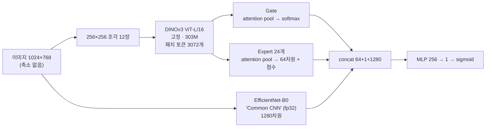

<div align="center">

# 🍓 Strawberry Fake Detector

**고정(frozen) DINOv3 백본과 Mixture-of-Experts head로 실제 vs 생성·변형 딸기 사진 판별하기**

한국어 · [English](README.md)

   

</div>

제1회 전국 농과계 대학 농업 AI 경진대회(이미지 미션) 프로젝트입니다. 딸기 시설재배 사진이 **실제 촬영(0)** 인지 **생성·합성·변형(1)** 인지 이진 분류합니다. 학습 데이터가 주어지지 않아서, 가짜 이미지를 직접 만드는 생성 파이프라인을 처음부터 구축하는 것이 작업의 절반이었습니다.

| | |
|---|---|
| **최종 결과** | 비공개 평가 524장(실제 262 / 가짜 262) 리더보드 **accuracy 0.85** |
| **모델** | 311M 파라미터, 0.64 GB, Colab T4에서 524장 **152초** (제한: 5분 · 오프라인 · 1GB 이하) |
| **팀** | 딥러닝 입문자 2명 — [@baejh3333-del](https://github.com/baejh3333-del), [@pjo789412-afk](https://github.com/pjo789412-afk) |
| **기간** | 2026-09-21 → 2026-10-16 (약 4주) |

## 하이라이트

- 🧱 **모델이 아니라 데이터를 만들었다** — 15종 이상의 생성기(FLUX, SDXL, Z-Image, Infinity, LaMa, inpainting, 고전 필터 등)로 약 1.7만 장을 생성. manifest·prompt 버전·포기(plant) 단위 split으로 재현성과 leakage 방지.
- 🔬 **내 validation 점수를 의심했다** — 내부 val 0.874, 리더보드 0.77. leave-one-generator-out(LOGO) 평가로 격차의 원인을 밝히고, 이후 모든 판단 기준으로 삼았다.
- 🧪 **결과를 보기 전에 채택 기준을 고정** — 마지막 실험 4개는 기준을 문서에 먼저 적었고, 전부 미달이라 제출하지 않았다.
- 📝 **실패도 그대로 기록** — 구조 실험 7개 중 6개는 효과가 없었다. 병목은 모델 용량이 아니라 생성 방식의 다양성이었다. → [docs/experiments.md](docs/experiments.md)

## 모델 구조



| 설계 선택 | 이유 |
|---|---|
| **축소하지 않고 조각으로 자름** | 블러·VAE 8픽셀 격자·편집 경계 같은 픽셀 단위 흔적은 축소하면 사라진다. |
| **DINOv3 고정** | 생성기당 수백~천 장뿐이라 fine-tuning하면 *내가 만든* 생성기의 지문을 외운다. |
| **attention pooling** | 부분 편집은 일부 조각에만 흔적이 있어 평균하면 묻힌다. |
| **전체 이미지 Common CNN** | 고주파 흔적(노이즈·JPEG)을 보완하고 입력 크기 제한이 없다. |
| **생성 방식별 Expert** | 생성기마다 지문이 다르다. Gate가 Expert를 섞는다. |

학습은 3 stage: (1) Expert + Common CNN, (2) Gate, (3) 전체를 `BCE + 0.2·GateCE + 0.1·SupCon`으로 학습 (SupCon은 같은 원본의 실제·가짜 쌍). 자세한 내용: [docs/architecture.md](docs/architecture.md)

## 결과

| 제출 | 변경 | 내부 검증 | 리더보드 |
|---|---|---|---|
| exp02 | 첫 본 학습 | acc 0.874 / AUROC 0.958 | **0.77** |
| exp06 | 복제·국소 필터 라벨 재배정 (E4 → E5) | acc 0.875 | ≈0.75 |
| exp11b (v3) | 생성 방식별 Expert 24개, 반응 없던 11방식 제외 | acc 0.885 / AUROC 0.964 | **0.83** |
| **v5 (최종)** | 가중치 동일, 판정 문턱 p ≥ 0.05 (마지막 bias에 `+ln 19`) | acc 0.901 | **0.85** |

문턱 이동이 가장 효과가 큰 단일 변경(+0.02)이었고 재학습이 필요 없습니다. val 2,681장과 사전에 정한 규칙으로 선택했습니다.

**알려진 약점** (일부러 공개): 처음 본 AI *편집* 모델의 부분 생성(unseen recall 0.32), `flux_vae` 재구성(recall ≈ 0), 높은 품질의 JPEG 재압축 가짜, 학습에 없는 품종의 실제 사진("AI Hub 스타일 ⇒ 실제"라는 지름길).

## 배운 것

1. **validation은 모르는 test를 흉내 내야 한다.** 내 val은 내가 만든 가짜뿐이었다. LOGO 평가가 낙관을 걷어내고 리더보드와 일치했다.
2. **데이터를 더 넣으면 나빠질 수 있다.** 국소 편집 2,100장 추가로 Expert recall이 0.81 → 0.69로 하락 (학습 불가 샘플 약 1,000장 = label noise). 라벨 하나를 재배정해 회복.
3. **구조를 만지기 전에 병목을 찾아라.** 구조 아이디어 7개를 하나씩 시험했으나 전부 잡음 수준. 효과는 데이터·판정 규칙에서 나왔다.
4. **실제 환경에서 시험하라.** 실제 가중치의 DINOv3 `.half()`는 T4에서만 NaN이 났다(CPU smoke test는 통과). 그대로 냈다면 약 50%였다.
5. **실패를 적어라.** → [docs/lessons-learned.md](docs/lessons-learned.md)

## 저장소 구조

```
├── submission/          # 제출한 추론 패키지: detector.py, inference.py, model/config.json
├── train/               # 3 stage trainer, 테스트, 진단 도구 (LOGO, 문턱 탐색, Expert 사용도…)
├── data_pipeline/       # 01–16: 실제 추출 → 필터 → 합성 → VAE 재구성 → inpaint → t2i → 스타일 → 국소 편집
├── tools/               # JPEG 스캐너, 이미지 정규화, 제출물 smoke test
├── docs/
│   ├── architecture.md          # 모델 명세
│   ├── data-and-generation.md   # 데이터 출처·생성기·라이선스
│   ├── experiments.md           # 모든 실험과 제출 (수치 포함)
│   └── lessons-learned.md       # 무엇이 왜 틀렸나
└── LICENSE
```

## 빠른 시작

```bash
pip install -r requirements.txt

# 1) 무작위 가중치로 추론 패키지 smoke test (데이터 불필요)
python tools/smoke_test_submission.py

# 2) 학습 (data_pipeline/ 으로 만든 manifest와 이미지 필요 — docs/data-and-generation.md 참고)
python train/train.py --data <DATA_DIR> --pretrained <PRETRAINED_DIR> --out <RUN_DIR> --stage all --family_map gen24
```

> **포함하지 않은 것:** 학습 이미지, 대회 제공 데이터, 학습된 가중치. 실제 사진은 [AI Hub](https://aihub.or.kr/aihubdata/data/view.do?dataSetSn=71451)(본인 활용만, 재배포 금지)에서 받고, 가짜는 `data_pipeline/`으로 다시 생성합니다. DINOv3 백본은 [DINOv3 License](submission/model/LICENSE_DINOv3.md)에 따라 별도로 내려받습니다.

## 설계가 지켜야 했던 대회 제약

오프라인 추론 · 실행 중 다운로드 금지 · T4에서 524장 5분 이내(GPU 없으면 CPU 동작) · 패키지 1GB 이하 · 허용된 패키지만 사용 · 입력 순서가 바뀌어도 같은 결과 · 재현 가능한 제출.

## License

코드: [MIT](LICENSE). 제3자 모델·데이터는 각자의 라이선스를 따릅니다 — [docs/data-and-generation.md](docs/data-and-generation.md)
