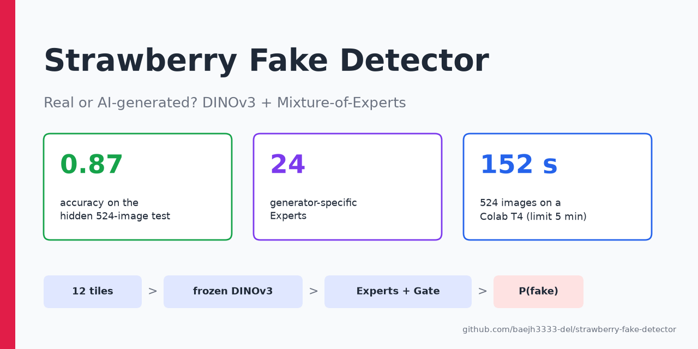
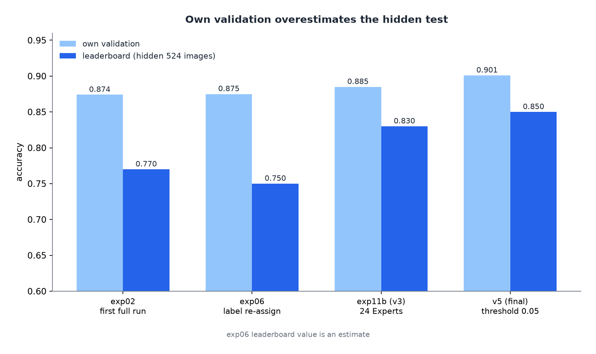
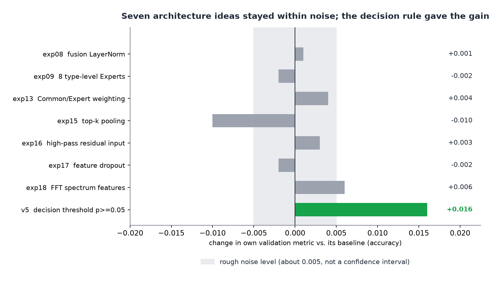
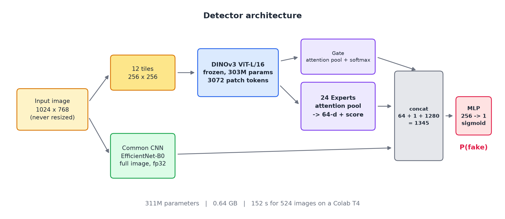
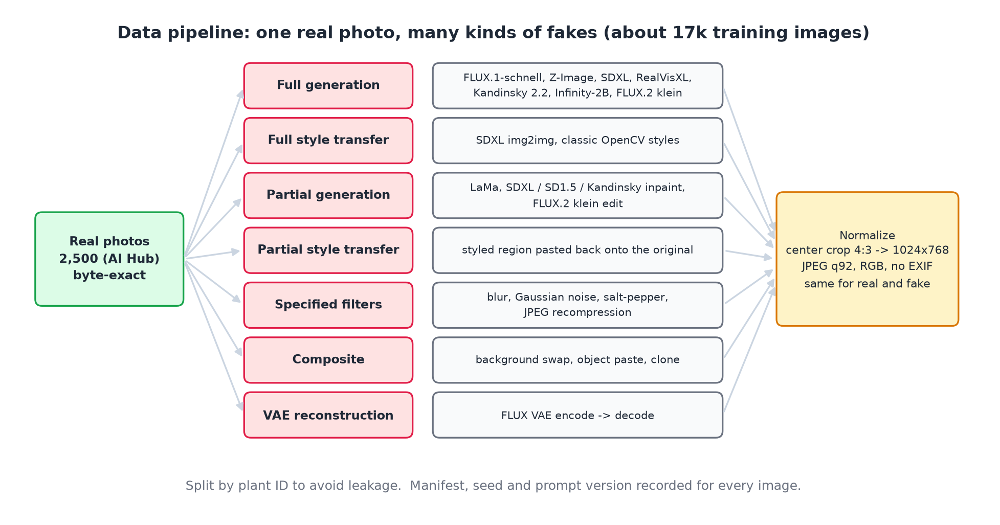

<div align="center">



[개요](#개요) · [결과](#결과) · [모델 구조](#모델-구조) · [데이터 파이프라인](#데이터-파이프라인) · [시행착오](docs/lessons-learned.md) · [English](README.md)

    

</div>

## 개요

생성형 AI 때문에 작물 사진을 만들거나 고치기가 쉬워지면서, 사진에 기댄 농업 기록을 믿기 어려워지고 있습니다. 이 프로젝트는 그 문제를 좁혀서 검증 가능한 형태로 다룹니다. 제1회 전국 농과계 대학 농업 AI 경진대회(이미지 미션)의 과제로, *이 딸기 시설재배 사진이 **실제 촬영(0)** 인지 **생성·합성·변형(1)** 인지* 가르는 이진 분류입니다.

**왜 어려운가**

- **학습 데이터가 없다.** 공개된 예시 이미지는 21장뿐이라 학습 데이터를 처음부터 직접 만들어야 했습니다.
- **가짜가 6종류**입니다. 전체를 생성한 이미지부터 사진의 몇 %만 바꾸는 국소 편집까지 있습니다.
- **처음 보는 생성기.** 평가용 가짜는 모델이 본 적 없는 방식으로 만들어져, 내 validation 점수가 비공개 평가를 과대평가했습니다(처음 0.874 vs 0.77).
- **엄격한 실행 제한.** 오프라인 추론, T4에서 524장 5분 이내, 1GB 이하.

**이 저장소가 주는 것**

1. 실제 사진을 15종 이상의 생성기·필터로 모든 종류의 가짜로 바꾸는 재현 가능한 파이프라인. 학습 풀은 약 1.7만 장입니다 ([`data_pipeline/`](data_pipeline)).
2. 픽셀 단위 흔적을 지키는 구조(원본 해상도 조각 + 고정 DINOv3)와, 생성기별 지문을 따로 배우는 Expert + Gate, 그리고 전체 이미지 CNN을 합친 detector.
3. validation과 비공개 평가의 격차를 설명해 준 평가 방식(leave-one-generator-out, 포기 단위 split).
4. 안 된 것과 그 이유를 솔직하게 적은 기록 ([docs/lessons-learned.md](docs/lessons-learned.md)).

## 한눈에 보기

| | |
|---|---|
| **프로젝트** | 딥러닝 입문자 2명, 4주 (2026-09-21 ~ 10-16) |
| **최종 점수** | 비공개 평가 524장(실제 262 / 가짜 262) **accuracy 0.87** |
| **모델** | 311M 파라미터, 0.64 GB, Colab T4에서 524장 **152초** (제한: 5분 · 오프라인 · 1GB 이하) |
| **핵심 아이디어** | 원본 해상도 조각 → 고정 DINOv3 → **생성 방식별 Expert**(attention pooling) + 고주파 잔차까지 보는 전체 이미지 CNN |
| **가장 쓸모 있던 발견** | 내부 validation 0.874, 비공개 평가 0.77. leave-one-generator-out 평가로 원인을 규명 |

## 결과



| 제출 | 변경 | 내부 검증 | 리더보드 |
|---|---|---|---|
| exp02 | 첫 본 학습 | acc 0.874 / AUROC 0.958 | 0.77 |
| exp06 | 복제·국소 필터 라벨 재배정 | acc 0.875 | ≈ 0.75 |
| exp11b (v3) | 생성 방식별 Expert 24개, 반응 없던 11방식 제외 | acc 0.885 / AUROC 0.964 | 0.83 |
| v5 | exp11b 가중치, 판정 문턱 p ≥ 0.05 (마지막 bias에 `+ln 19`) | acc 0.901 | 0.85 |
| **v7 (최종)** | exp11b 설정 + Common CNN에 **고주파 잔차 입력**(exp16), 같은 문턱 이동 | acc 0.902 | **0.87** |

내 검증 기준으로는 구조 아이디어 7개(LayerNorm, top-k pooling, 고주파 입력, dropout, FFT 등) 모두 잡음 수준을 넘지 못했습니다. 그중 하나인 **고주파 잔차 입력**(exp16)이 리더보드 최고 모델에 들어갔습니다. v7은 0.87, v5는 0.85였는데 검증은 둘을 같게 봤습니다(균형 정확도 0.814 vs 0.813). 이 차이는 524장 중 약 10장(표준오차 ≈ 1.5%p)이라 한 번의 비교로 효과를 입증하거나 부정할 수는 없습니다. 일관되게 남은 병목은 모델 용량이 아니라 **모델이 본 생성기의 종류**였습니다.



> 실험당 1회 실행(seed 반복 없음). 음영은 비슷한 실행 사이에서 보인 대략적인 잡음 수준(±0.005)이며 측정된 신뢰구간이 아닙니다. 주황색은 최종 모델에 들어간 아이디어입니다. 전체 표: [docs/experiments.md](docs/experiments.md)

## 모델 구조



| 설계 선택 | 이유 |
|---|---|
| **원본 해상도 조각 12장, 축소 없음** | 블러·VAE 8픽셀 격자·편집 경계 같은 픽셀 단위 흔적은 축소하면 사라진다. |
| **DINOv3 고정** | 생성기당 수백~천 장뿐이라 fine-tuning하면 *내가 만든* 생성기 지문을 외운다. |
| **attention pooling** | 부분 편집은 일부 조각에만 흔적이 있어 평균하면 묻힌다. |
| **전체 이미지 Common CNN** | 고주파 흔적(노이즈·JPEG)을 보완하고 입력 크기 제한이 없다. 최종 모델은 RGB에 고주파 잔차를 붙인 6채널을 입력한다. |
| **생성 방식별 Expert + Gate** | 생성기마다 지문이 다르다. |

학습: (1) Expert + Common CNN → (2) Gate → (3) 전체를 `BCE + 0.2·GateCE + 0.1·SupCon`으로 (SupCon은 같은 원본의 실제·가짜 쌍). 자세히: [docs/architecture.md](docs/architecture.md)

## 데이터 파이프라인



15종 이상의 생성기로 약 1.7만 장. train/val은 **포기(plant) ID** 단위로 나눠 leakage를 막았고, leave-one-generator-out fold로 처음 본 방식에 대한 일반화를 쟀습니다. 출처·라이선스·프롬프트: [docs/data-and-generation.md](docs/data-and-generation.md)

## 빠른 시작

```bash
pip install -r requirements.txt

# 1) 무작위 가중치로 추론 패키지 smoke test (데이터 불필요)
python tools/smoke_test_submission.py

# 2) 학습 (data_pipeline/ 으로 만든 manifest와 이미지 필요)
python train/train.py --data <DATA_DIR> --pretrained <PRETRAINED_DIR> --out <RUN_DIR> --stage all --family_map gen24
```

> **참고:** `submission/model/config.json`은 기본 템플릿(Expert 5개)입니다. `--family_map gen24`로 학습하면 내보내는 config에 `n_experts: 24`가 기록되며, 최종 모델이 이 설정이었습니다.
>
> **포함하지 않은 것:** 학습 이미지, 대회 제공 데이터, 학습된 가중치. 실제 사진은 [AI Hub](https://aihub.or.kr/aihubdata/data/view.do?dataSetSn=71451)(본인 활용만, 재배포 금지)에서 받고, 가짜는 `data_pipeline/`으로 다시 생성합니다. DINOv3 백본은 [DINOv3 License](submission/model/LICENSE_DINOv3.md)에 따라 별도로 내려받습니다.

## 저장소 구조

```
submission/       제출한 추론 패키지 (detector.py, inference.py, model/config.json)
train/            3 stage trainer, 단위 테스트, 진단 도구 (LOGO, 문턱 탐색, Expert 사용도)
data_pipeline/    01–16: 실제 추출 → 필터 → 합성 → VAE 재구성 → inpaint → t2i → 스타일 → 국소 편집
tools/            JPEG 스캐너, 이미지 정규화, 제출물 smoke test
assets/           그림 (assets/make_figures.py로 재생성)
docs/             architecture · data-and-generation · experiments · lessons-learned
```

## 알려진 한계

처음 본 **AI 편집 모델**이 만든 부분 생성(unseen recall 0.32), FLUX-VAE 재구성(recall ≈ 0), 높은 품질의 JPEG 재압축 가짜, 학습에 없는 품종의 실제 사진("AI Hub 스타일 ⇒ 실제"라는 지름길). 분석: [docs/lessons-learned.md](docs/lessons-learned.md)

## 팀

[@baejh3333-del](https://github.com/baejh3333-del) · [@pjo789412-afk](https://github.com/pjo789412-afk)

## 감사의 말

[DINOv3](https://github.com/facebookresearch/dinov3) (Meta), [timm](https://github.com/huggingface/pytorch-image-models), [Hugging Face Transformers / Diffusers](https://github.com/huggingface), [LaMa](https://github.com/advimman/lama), FLUX, Stable Diffusion XL, Z-Image, Infinity, Kandinsky, AI Hub 딸기 데이터셋.

## License

코드: [MIT](LICENSE). 제3자 모델·데이터는 각자의 라이선스를 따릅니다 ([상세](docs/data-and-generation.md)).
