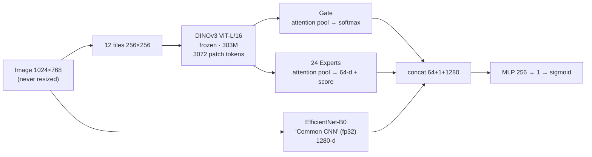

<div align="center">

# 🍓 Strawberry Fake Detector

**Detecting real vs. AI-generated / edited strawberry photos with a frozen DINOv3 backbone and a Mixture-of-Experts head**

[한국어](README.ko.md) · English

   

</div>

A project for the 1st National Agricultural AI Competition (Korea, image mission): given a greenhouse strawberry photo, decide whether it is a **real photograph (0)** or **generated / composited / manipulated (1)**. The training data was *not* provided, so half of the work was building a fake-image generation pipeline from scratch.

| | |
|---|---|
| **Final result** | **0.85 accuracy** on the hidden 524-image leaderboard set (262 real / 262 fake) |
| **Model** | 311M parameters, 0.64 GB, **152 s** for 524 images on a Colab T4 (limit: 5 min, offline, ≤1 GB) |
| **Team** | 2 beginners in deep learning — [@baejh3333-del](https://github.com/baejh3333-del), [@pjo789412-afk](https://github.com/pjo789412-afk) |
| **Period** | 2026-09-21 → 2026-10-16 (about 4 weeks) |

## Highlights

- 🧱 **Built the dataset, not just the model** — 17k images from 15+ generators (FLUX, SDXL, Z-Image, Infinity, LaMa, inpainting, classic filters…) with reproducible manifests, prompt versions and plant-level train/val splits to avoid leakage.
- 🔬 **Distrusted my own validation score** — internal val said 0.874, the leaderboard said 0.77. A leave-one-generator-out (LOGO) evaluation explained the gap and became the metric for every later decision.
- 🧪 **Pre-registered acceptance criteria** — before seeing results of the last four experiments, I fixed thresholds in writing. All four failed and were not submitted; the validated model stayed final.
- 📝 **Honest negative results** — 6 of 7 architecture experiments did nothing. The bottleneck was generator diversity, not model capacity. See [docs/experiments.md](docs/experiments.md). *(Deep-dive docs are written in Korean.)*

## Architecture



| Design choice | Why |
|---|---|
| **Tiles, no resizing** | Blur, VAE 8-px grids and edit boundaries are pixel-level traces that downscaling destroys. |
| **Frozen DINOv3** | Few thousand images per generator → fine-tuning would memorize *my* generators' fingerprints. |
| **Attention pooling** | A local edit lives in a few tiles; mean pooling would wash it out. |
| **Common CNN on the full image** | Complements the ViT on high-frequency traces (noise, JPEG) and has no input-size limit. |
| **One Expert per generation method** | Different generators leave different fingerprints; a Gate mixes the Experts. |

Training runs in three stages — (1) Experts + Common CNN, (2) Gate, (3) everything with `BCE + 0.2·GateCE + 0.1·SupCon` where SupCon pairs a real image with fakes made from it. Details: [docs/architecture.md](docs/architecture.md).

## Results

| Submission | Change | Own validation | Leaderboard |
|---|---|---|---|
| exp02 | first full training | acc 0.874 / AUROC 0.958 | **0.77** |
| exp06 | re-assign "clone / local filter" labels (E4 → E5) | acc 0.875 | ≈0.75 |
| exp11b (v3) | one Expert per generation method (24), drop 11 inert methods | acc 0.885 / AUROC 0.964 | **0.83** |
| **v5 (final)** | same weights, decision threshold p ≥ 0.05 (`+ln 19` on the last bias) | acc 0.901 | **0.85** |

The threshold shift was the single most effective change (+0.02) and costs no retraining; it was chosen on 2,681 validation images with a rule fixed in advance.

**Known weaknesses** (kept in the open on purpose): fakes produced by an unseen AI *editing* model (partial generation recall 0.32 on unseen methods), `flux_vae` reconstructions (recall ≈ 0), high-quality JPEG-recompression fakes, and real photos from varieties absent from training (shortcut: "AI Hub style ⇒ real").

## What I learned

1. **Validation must imitate the unknown test.** My val set contained only fakes I made. LOGO evaluation cut the optimism and matched the leaderboard.
2. **More data can hurt.** Adding 2,100 local edits dropped Expert recall 0.81 → 0.69 because ~1,000 were unlearnable (label noise); re-assigning one label recovered it.
3. **Find the bottleneck before touching the architecture.** Seven structural ideas, one change at a time, all within noise — the fix was data and decision rules.
4. **Test on the real environment.** `.half()` on DINOv3 produced NaN on a T4 only with real weights; a CPU smoke test passed. Shipping it would have scored ≈ 50%.
5. **Write failures down.** More in [docs/lessons-learned.md](docs/lessons-learned.md).

## Repository layout

```
├── submission/          # submitted inference package: detector.py, inference.py, model/config.json
├── train/               # 3-stage trainer, tests, diagnostics (LOGO, threshold scan, expert usage…)
├── data_pipeline/       # 01–16: real extraction → filters → composites → VAE recon → inpaint → t2i → style → local edits
├── tools/               # JPEG scanner, image normalizer, submission smoke test
├── docs/
│   ├── architecture.md          # model spec
│   ├── data-and-generation.md   # data sources, generators, licenses
│   ├── experiments.md           # every experiment & submission with numbers
│   └── lessons-learned.md       # what went wrong and why
└── LICENSE
```

## Quick start

```bash
pip install -r requirements.txt

# 1) Smoke-test the inference package with random weights (no data needed)
python tools/smoke_test_submission.py

# 2) Train (expects a manifest + images produced by data_pipeline/, see docs/data-and-generation.md)
python train/train.py --data <DATA_DIR> --pretrained <PRETRAINED_DIR> --out <RUN_DIR> --stage all --family_map gen24
```

> **Not included:** training images, the contest-provided data and the trained weights. Real photos come from [AI Hub](https://aihub.or.kr/aihubdata/data/view.do?dataSetSn=71451) (personal-use terms, no redistribution); fakes are regenerated with `data_pipeline/`. The DINOv3 backbone is downloaded separately under the [DINOv3 License](submission/model/LICENSE_DINOv3.md).

## Competition constraints this design had to respect

Offline inference, no downloads at run time, ≤ 5 min for 524 images on a T4 (CPU fallback required), ≤ 1 GB package, only the allowed Python packages, permutation-invariant predictions, and a reproducible submission.

## License

Code: [MIT](LICENSE). Third-party models and datasets keep their own licenses — see [docs/data-and-generation.md](docs/data-and-generation.md).
